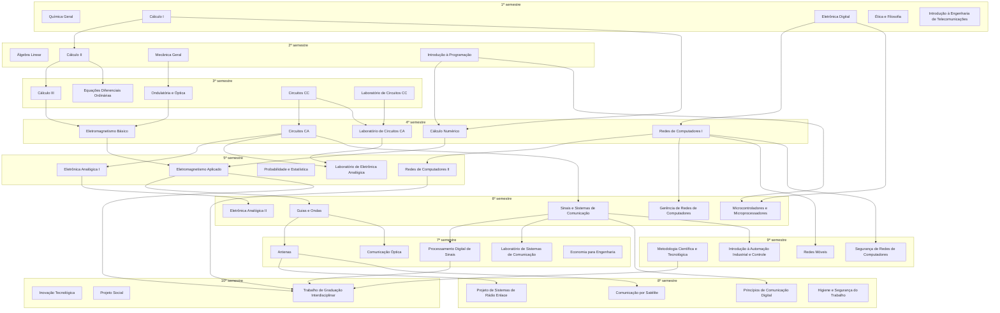

# Fluxograma de pré-requisitos

Disciplinas obrigatórias da matriz 2018.2, por semestre. Uma seta **A → B** quer dizer que **A é pré-requisito de B**. Os pré-requisitos das optativas estão na [pasta de optativas](../optativas/).

## Lista por disciplina

| Disciplina | Semestre | Pré-requisitos |
|---|---|---|
| Química Geral | 1º | — |
| Cálculo I | 1º | — |
| Eletrônica Digital | 1º | — |
| Ética e Filosofia | 1º | — |
| Introdução à Engenharia de Telecomunicações | 1º | — |
| Álgebra Linear | 2º | — |
| Cálculo II | 2º | Cálculo I |
| Mecânica Geral | 2º | — |
| Introdução à Programação | 2º | — |
| Ondulatória e Óptica | 3º | Mecânica Geral |
| Cálculo III | 3º | Cálculo II |
| Equações Diferenciais Ordinárias | 3º | Cálculo II |
| Circuitos CC | 3º | — |
| Laboratório de Circuitos CC | 3º | — |
| Eletromagnetismo Básico | 4º | Ondulatória e Óptica, Cálculo III |
| Cálculo Numérico | 4º | Cálculo I, Introdução à Programação |
| Redes de Computadores I | 4º | Eletrônica Digital |
| Circuitos CA | 4º | Circuitos CC |
| Laboratório de Circuitos CA | 4º | Circuitos CC, Laboratório de Circuitos CC |
| Eletromagnetismo Aplicado | 5º | Eletromagnetismo Básico, Cálculo Numérico |
| Redes de Computadores II | 5º | Redes de Computadores I |
| Probabilidade e Estatística | 5º | — |
| Eletrônica Analógica I | 5º | Circuitos CA |
| Laboratório de Eletrônica Analógica | 5º | Circuitos CA, Laboratório de Circuitos CA |
| Guias e Ondas | 6º | Eletromagnetismo Aplicado |
| Gerência de Redes de Computadores | 6º | Redes de Computadores I |
| Sinais e Sistemas de Comunicação | 6º | Circuitos CA |
| Eletrônica Analógica II | 6º | Eletrônica Analógica I |
| Microcontroladores e Microprocessadores | 6º | Eletrônica Digital, Introdução à Programação |
| Antenas | 7º | Guias e Ondas |
| Comunicação Óptica | 7º | Guias e Ondas |
| Processamento Digital de Sinais | 7º | Sinais e Sistemas de Comunicação |
| Laboratório de Sistemas de Comunicação | 7º | Sinais e Sistemas de Comunicação |
| Economia para Engenharia | 7º | — |
| Projeto de Sistemas de Rádio Enlace | 8º | Antenas |
| Comunicação por Satélite | 8º | Antenas |
| Princípios de Comunicação Digital | 8º | Sinais e Sistemas de Comunicação |
| Higiene e Segurança do Trabalho (HST) | 8º | — |
| Metodologia Científica e Tecnológica | 9º | — |
| Redes Móveis | 9º | Redes de Computadores I |
| Segurança de Redes de Computadores | 9º | Redes de Computadores I |
| Introdução à Automação Industrial e Controle | 9º | Sinais e Sistemas de Comunicação |
| Inovação Tecnológica | 10º | — |
| Projeto Social | 10º | — |
| Trabalho de Graduação Interdisciplinar (TGI) | 10º | Eletromagnetismo Aplicado, Redes de Computadores II, Processamento Digital de Sinais, Metodologia Científica e Tecnológica |

> Fonte: matriz curricular 11892 (2018.2). Se os pré-requisitos mudarem, atualize este arquivo e os READMEs das disciplinas.
